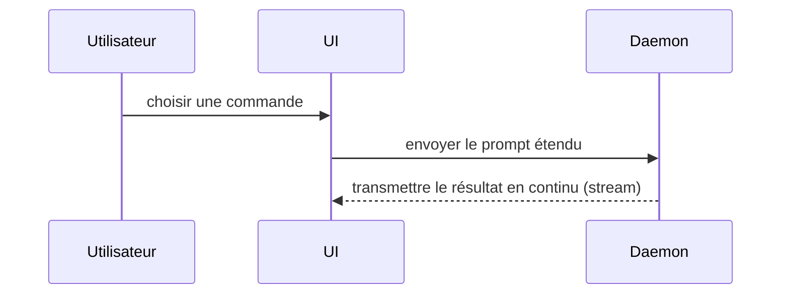

Utilisez ce modèle pour la rédaction du corps de la PR :

```markdown
## Résumé

<diagramme, esquisse de diff, ou arborescence>

## Preuve

- **Avant :** <capture d'écran/sortie/exécution de test échouée>
  **Après :** <capture d'écran/sortie/exécution de test réussie>

## Danger de la fusion (Merge Danger)

**Porte :** <un sens ou double sens>

<optionnel : description>

**Périmètre d'impact (Blast Radius) :** <description en un mot>

<optionnel : ramifications potentielles de la fusion>
```

## Sections

Omettez toute préambule et gardez un texte concis. Utilisez le jargon/domaine de l'utilisateur défini dans `GLOSSARY.md`.

### Résumé

Choisissez la vue la plus réduite possible qui rend le point clé explicite.

- Représentez la logique ou un algorithme sous forme de pseudo-code :

```text
on(save)
  si le contenu est inchangé
    renvoyer le résultat en cache
  écrire le nouveau contenu
  renvoyer le résultat frais
```

- Représentez le flux de contrôle à l'exécution sous forme d'arbre d'appels :

```text
submitForm
  createSession
    persistPrompt
    launchAgent
  navigateToSession
```

- Représentez la structure de l'interface utilisateur sous forme d'arbre de composants, en incluant l'état et les frontières de modules pertinentes :

```text
<SessionPage> (apps/example/src/routes/session.tsx)
  useSessionEvents()
  <SessionToolbar>
    <RunSkillButton> (packages/ui)
```

- Représentez la responsabilité d'un fichier ou un refactoring global sous forme d'arbre de fichiers simplifié :

```text
src/
├── commands/       # analyse les actions de l'utilisateur
├── sessions/       # gère l'état de la session
└── transport/      # envoie les requêtes API
```

- Représentez l'interaction entre composants, le flux de contrôle ou le flux de données avec Mermaid :



- Utilisez un `diff` lorsque l'élément essentiel réside dans ce qui change et que la structure globale existe déjà. Adaptez la forme du diff au sujet.

Pour un changement de composant :

```diff
 <SessionPage>
   useSessionEvents()
   <SessionToolbar>
+    <RunSkillButton />
   <SessionTimeline>
+    <SkillResultCard />
```

Pour un changement de structure de fichiers :

```diff
 src/
 ├── commands/
+│   └── show-me.ts       # étend la commande slash
 ├── sessions/
-└── transport.ts
+└── transport/
+    ├── client.ts
+    └── stream.ts
```

Pour un changement dans l'arbre ou la pile d'appels :

```diff
 submitForm
   createSession
     persistPrompt
+    expandSkillMention
     launchAgent
-  navigateToSession
+  navigateToSession
+    subscribeToEvents
```

Pour un changement d'état ou de flux de contrôle :

```diff
 on(save)
-  write content
+  si le contenu est inchangé
+    renvoyer le résultat en cache
+  écrire le nouveau contenu
+  invalider le cache
```

- Affichez le bloc complet lorsque la majeure partie est nouvelle, lorsque l'omission du contexte masquerait l'appartenance ou l'ordre, ou lorsque l'utilisateur a besoin d'un modèle cible facilement copiable :

```ts
function expandSkill(command: string): string {
  const skillName = command.slice(1);
  return `use the ${skillName} skill`;
}
```

#### Directives

Placez chaque élément visuel à côté du texte court qu'il étaye. Ne conservez que les appels, fichiers, props, états et frontières nécessaires pour répondre à la question actuelle de l'utilisateur ou aux options permettant de résoudre le point de discussion en cours.

Vous pouvez en utiliser un ou plusieurs, mais il est peu probable que vous les utilisiez tous. Faites preuve de discernement et ne surchargez pas l'utilisateur.

### Preuve

Preuve concrète que le changement fonctionne. Présentez un avant et un après.

Les captures d'écran sont le niveau maximal (S-tier) — lorsque l'environnement y est prêt et que le changement est visuel.

#### Captures d'écran dans la PR

Tout changement visuel (page, composant, CSS, mise en page) joint ses captures dans la description. `gh` ne sait pas téléverser une image dans une description : on les publie sur une branche dédiée `pr-screens`, jamais sur la branche de la PR ni sur la branche principale, pour ne pas alourdir l'historique du code.

1. **Prendre les captures.** Un avant (build de la branche de base) et un après, par page concernée, aux largeurs utiles (au minimum bureau 1100 px et mobile 390 px). Si le site est multilingue, la langue par défaut suffit, plus une langue à textes longs (allemand) quand la mise en page peut casser. Noms explicites : `avant-<page>-<largeur>.png`, `apres-<page>-<largeur>.png`. Pas de donnée personnelle ni de secret à l'écran.
2. **Alléger.** Redimensionner à 1100 px de large au plus et viser moins de 300 Ko par image (JPEG qualité 80 ou PNG optimisé).
3. **Publier.** Utiliser un worktree dédié sur la branche orpheline `pr-screens` (la créer si elle n'existe pas : `git worktree add --orphan -b pr-screens <dossier>`, ou `git checkout --orphan` sur un git plus ancien). Copier les images dans `<nom-de-la-branche-de-la-PR avec les / remplacés par ->/`, committer sans ligne d'attribution, pousser `pr-screens`. Retirer le worktree ensuite.
4. **Référencer par commit.** Dans la section « Preuve », un tableau avant / après avec des liens figés sur le SHA du commit de `pr-screens` : ``. Un dépôt privé n'affiche les images qu'aux personnes ayant accès, ce qui est voulu.
5. **Montrer aussi à l'utilisateur** les captures dans la conversation (fichier joint) quand l'outil existe, avant d'ouvrir la PR.
6. Si les captures sont impossibles (environnement non prêt), le dire dans la section « Preuve » et donner à la place la preuve par exécution.

Quand le travail est confié à un worker, son brief demande les captures avant et après dans un dossier non suivi par git avec les noms ci-dessus ; la publication sur `pr-screens` revient à la personne qui ouvre la PR.

Les preuves basées sur l'exécution constituent le niveau A-tier. Résultats de tests, sorties de console. Montrez le test exact qui échoue puis réussit, en utilisant du pseudo-code.

### Danger de la fusion (Merge Danger)

Indiquez s'il s'agit d'une porte à un sens (sans retour) ou à double sens. On peut revenir en arrière à travers une porte à double sens, mais pas à travers une porte à un sens. Une PR simple à annuler (rollback) présente un risque plus faible. Les modifications impliquant des actions destructrices ou des décisions difficiles à inverser sont des portes à un sens.

Le périmètre d'impact (Blast Radius) représente la portée ou l'impact potentiel des modifications introduites par cette PR. Envisagez toutes les possibilités. Exemples : décalage de mise en page (layout shift), ruptures pour les utilisateurs/consommateurs, réactivité sur mobile, etc.